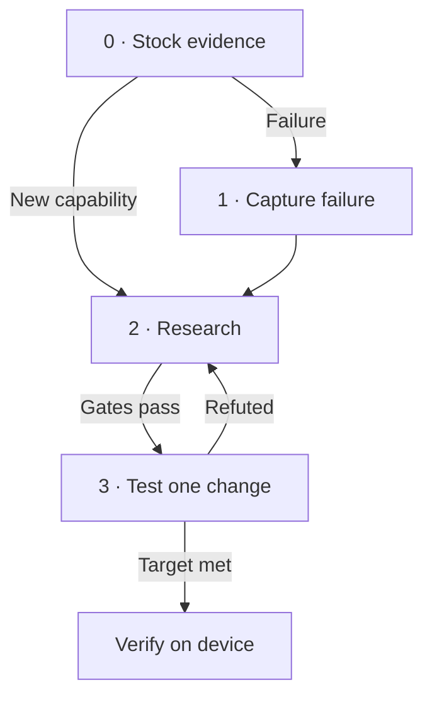

# linux-phone-porting

<p align="center">
  
</p>

An evidence-first agent skill for bringing up mainline Linux on phones and tablets. A blind build, flash, and boot costs 5–10 minutes; make each trial answer one question.

**Contents:** [Install](#install) · [Requirements](#requirements) · [Workflow](#the-four-phases) · [Commands](#commands) · [Workspace](#recommended-folder-structure) · [Changelog](#changelog)

## Install

Clone to an unused destination:

```sh
git clone https://github.com/angelwzr/linux-phone-porting
```

- **Agent with skill discovery:** register the checkout using the agent's documented configuration.
- **Any agent that can read Markdown:** give it [SKILL.md](SKILL.md) and your device and goal. Attach the file if the agent can't read your checkout.

Use the same checkout for any optional [commands](#commands). Preserve existing files and links; keep development edits in a separate clone.

## Requirements

The device needs a **demonstrated boot path**: an already-unlocked bootloader on retail-unlock targets, an already-working payload on exploit-booted hardware, or a proven way to boot your image on firmware-boot hardware. The skill does not provide unlock or exploit steps.

The method covers mainline Linux and its target userspace; it is not a device or distro compatibility list.

## Updating

Between hardware sessions, run `/linux-phone-porting-update` or read [the updater instructions](commands/linux-phone-porting-update.md) directly. Give it the installed checkout's path. It reviews the candidate revision before updating a clean checkout and only reconciles links for registered commands. For older installs without the updater, use the [current upstream instructions](https://github.com/angelwzr/linux-phone-porting/blob/main/commands/linux-phone-porting-update.md). Restart the agent session after updating.

## The four phases



Stop if the falsifier or a safety prerequisite is missing. A research-only request stops at a host-side gate report: no device access, staging, or reboot. Excluding userdata from a backup does not authorize erasing it.

After three refutations, widen the search. A missing receipt is not a refutation. Verify reboot and runtime before cleanup.

The skill originated in one real port — mainline Linux on a Xiaomi Mi A3, running NixOS on kernels 7.1 and 7.2 — and now incorporates lessons from other ports while keeping each measurement's scope explicit.

## Commands

Use a registered slash command or give your agent the linked file alongside `SKILL.md`. If it names another command, open that file the same way. Parallel subagents are optional; sequential sweeps use the same coverage ledger.

| Command                                                                 | When to use it                                          |
| ----------------------------------------------------------------------- | ------------------------------------------------------- |
| [`/port-setup`](commands/port-setup.md)                                 | Starting a port; stock evidence is still available      |
| [`/evidence-sweep`](commands/evidence-sweep.md)                         | A trial failed and you need evidence                    |
| [`/source-sweep`](commands/source-sweep.md)                             | You have evidence and need a hypothesis                 |
| [`/port-research`](commands/port-research.md)                           | You want to add an unproven capability                  |
| [`/flash-gate`](commands/flash-gate.md)                                 | A candidate is ready for its cheapest decisive test     |
| [`/port-loop`](commands/port-loop.md)                                   | Iterate within an agreed scope and refutation budget    |
| [`/port-upstream`](commands/port-upstream.md)                           | Prepare a patch or report for operator-owned submission |
| [`/port-cleanup`](commands/port-cleanup.md)                             | Reclaim host space without losing recovery inputs       |
| [`/port-update`](commands/port-update.md)                               | Upgrade and reverify port components                    |
| [`/linux-phone-porting-update`](commands/linux-phone-porting-update.md) | Update the installed skill, not the port                |

## Recommended folder structure

For a multi-device workspace, keep device-specific code out of the shared layers:

```text
kernel/<version>/     Upstream source and generic builder
soc/<vendor-soc>/     SoC-common patches and configuration
os/<platform>/        Device-neutral integration and tooling
devices/<model>/      Device assembly and state
```

Keep private backups, harvested firmware, and raw debug evidence in gitignored `artifacts/`; keep one log directory per boot under `logs/`. Never publish private calibration or raw backups.

## Pairs well with

None are required. The skill falls back to source, documentation, and web search.

- `linux-kernel-development` or `linux-kernel-crash-debug` for kernel analysis.
- `find-docs` and `wigolo` for current docs and source sweeps.
- `graft` and `lei` for indexed source and Linux mailing-list archives.
- [Sashiko](https://github.com/sashiko-dev/sashiko) or [Boro](https://github.com/NVIDIA/boro) for optional patch review within approved disclosure and spending limits. Verify findings against source or reproduction.

## Cost

An earlier estimate put the loaded `SKILL.md` and one command at about 20–21k tokens. The detail captures costly failure modes, including one 28 MiB reserved-memory shortfall that caused roughly 340 hard wedges. See the [full history](CHANGELOG.md) for measurements and the compression audit.

## Changelog

- **2026-11-22**
  - **Firmware display.** Verify physical output separately from rendered frames.
  - **USB topology.** No enumerated devices does not prove a controller is unwired.
  - **README.** Agent-neutral quick start, shorter command reference, and a workflow diagram.

Full history in [CHANGELOG.md](CHANGELOG.md).

## License

[CC BY 4.0](LICENSE) © [Roman Linev](https://rlinev.ru).
