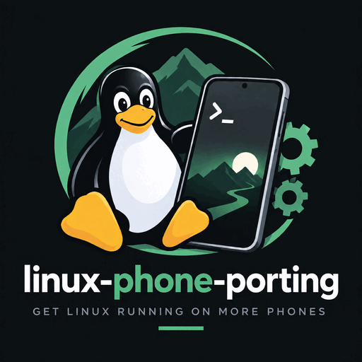
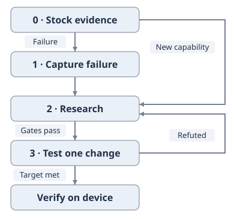

# linux-phone-porting

<p align="center">
  
</p>

An agent skill for bringing up mainline Linux on phones and tablets. A build, flash, and boot can take 5–10 minutes. Gather evidence before you spend a boot on a guess.

**Contents:** [Install](#install) · [Requirements](#requirements) · [Update the skill](#updating) · [Workflow](#the-four-phases) · [Examples](#examples) · [Commands](#commands) · [Workspace](#recommended-folder-structure) · [Achievements](#achievements) · [Changelog](#changelog)

## Install

Clone to an unused destination:

```sh
git clone https://github.com/angelwzr/linux-phone-porting
```

- If your agent supports skills, register the checkout using its setup instructions.
- Otherwise, give your agent [SKILL.md](SKILL.md), the exact device, and your goal. Attach the file if the agent cannot read your checkout.

Use the same checkout for optional [commands](#commands). Leave existing files and links in place. Use a separate clone to edit the skill.

## Requirements

Start with a demonstrated boot path: an already-unlocked bootloader on retail-unlock hardware, a payload that already boots on exploit-booted hardware, or a proven way to boot the target image on firmware-boot hardware. The skill does not provide unlock or exploit steps.

The skill covers mainline Linux and userspace integration. It does not certify any device or distro combination.

## Updating

Between hardware sessions, run `/linux-phone-porting-update` or give your agent [the updater instructions](commands/linux-phone-porting-update.md) and the installed path. The updater inspects the candidate before advancing a clean manual checkout. It skips command links if none are registered. For older installs without the updater, use the [current upstream instructions](https://github.com/angelwzr/linux-phone-porting/blob/main/commands/linux-phone-porting-update.md). Restart the agent session after updating.

## The four phases



The agent moves to the next phase when its prerequisites are met. The operator confirms the target and authorizes device actions. In phase 3, record what would disprove the hypothesis before running the cheapest authorized test. A research-only request allows no device access, staging, next-boot selection, or reboot.

Widen the search after three refutations. A missing receipt does not refute the hypothesis. Verify reboot and runtime before retiring old deployments. Excluding userdata from a backup does not authorize erasing it.

The skill originated in one real port — mainline Linux on a Xiaomi Mi A3, running NixOS on kernels 7.1 and 7.2 — and now incorporates lessons from other ports while keeping each measurement's scope explicit.

## Examples

**Research prompt:** “Using the existing stock artifacts, research touchscreen support on this board. Don’t access or reboot the device.”

[`/port-research`](commands/port-research.md) returns a ranked plan with sources, the smallest test and what would disprove the hypothesis, plus a host-only gate report.

**Display bring-up:** On one port, the desktop still rendered after seven minutes, but the backlit panel stayed black. Preventing the display clocks from being parked and keeping the power domain on restored visible output. That verified [firmware framebuffer output](SKILL.md#3-implement-only-with-a-promising-evidence-backed-hypothesis), not the native panel driver.

## Commands

Run a registered slash command or give your agent the linked file with `SKILL.md`. If a command calls another, load that file too. Without parallel subagents, use the same source ledger in order.

| Command                                                                 | When to use it                                          |
| ----------------------------------------------------------------------- | ------------------------------------------------------- |
| [`/port-setup`](commands/port-setup.md)                                 | Starting a port; stock evidence is still available      |
| [`/evidence-sweep`](commands/evidence-sweep.md)                         | A trial failed and you need evidence                    |
| [`/source-sweep`](commands/source-sweep.md)                             | You have evidence and need a hypothesis                 |
| [`/port-research`](commands/port-research.md)                           | You want to add an unproven capability                  |
| [`/flash-gate`](commands/flash-gate.md)                                 | A candidate is ready for its cheapest decisive test     |
| [`/port-loop`](commands/port-loop.md)                                   | Iterate within an agreed scope and refutation budget    |
| [`/port-upstream`](commands/port-upstream.md)                           | Prepare a patch or report for operator-owned submission |
| [`/port-cleanup`](commands/port-cleanup.md)                             | Reclaim host space without losing recovery inputs       |
| [`/port-update`](commands/port-update.md)                               | Upgrade and reverify port components                    |
| [`/linux-phone-porting-update`](commands/linux-phone-porting-update.md) | Update the installed skill, not the port                |

## Recommended folder structure

For a multi-device workspace, keep device-specific code out of the shared layers:

```text
kernel/<version>/     Upstream source and generic builder
soc/<vendor-soc>/     SoC-common patches and configuration
os/<platform>/        Device-neutral integration and tooling
devices/<model>/      Device assembly and state
```

Keep private backups, harvested firmware, and raw debug evidence in gitignored `artifacts/`; keep one log directory per boot under `logs/`. Never publish private calibration or raw backups.

## Pairs well with

None are required. The skill falls back to source, documentation, and web search.

- `linux-kernel-development` or `linux-kernel-crash-debug` for kernel analysis.
- `find-docs` and `wigolo` for current docs and source sweeps.
- `graft` and `lei` for indexed source and Linux mailing-list archives.
- [Sashiko](https://github.com/sashiko-dev/sashiko) or [Boro](https://github.com/NVIDIA/boro) for optional patch review. Get approval for disclosure and spending; check findings against source or reproduction.

## Cost

An earlier estimate put the loaded `SKILL.md` and one command at about 20–21k tokens. The detail captures costly failure modes, including one 28 MiB reserved-memory shortfall that caused roughly 340 hard wedges. See the [full history](CHANGELOG.md) for measurements and the compression audit.

## Achievements

- **Qualcomm FastRPC:** [PR #393](https://github.com/qualcomm/fastrpc/pull/393) merged. It validates DSP-supplied buffer lengths.
- **Linux device tree:** The Qualcomm maintainer [applied the SM6125 `reserved_mem1` fix](https://lore.kernel.org/linux-arm-msm/179416929229.628393.16390580991068177022.b4-ty@b4/) to reserve another 28 MiB for firmware.

## Changelog

- **2026-11-25**
  - **Workflow diagram.** Show the research-only exit and keep verification in phase 3.
  - **README and commands.** Use plainer language for setup, research, testing, and maintenance.
  - **Examples.** Show a research-only prompt and a measured display result.
  - **Achievements.** Link two contributions from porting work and state where each landed.

Full history in [CHANGELOG.md](CHANGELOG.md).

## License

[CC BY 4.0](LICENSE) © [Roman Linev](https://rlinev.ru).
